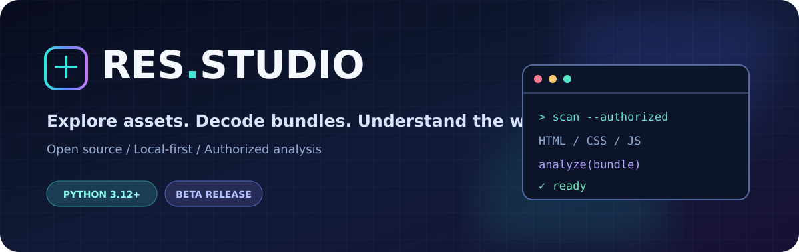

<div align="center">



<br />

[](https://github.com/res-studio/res-studio/releases)
[](https://github.com/res-studio/res-studio/actions)
[](LICENSE)
[](SECURITY.md)

**Open-source website inspection, JavaScript deobfuscation and bundle analysis toolkit.** Discover HTML, CSS, JS assets, explore Webpack-style bundles with Webcrack, inspect observable API requests, and export findings.

*Local-first · Open source · For websites you own or are authorized to inspect*

[**Get started**](#quick-start) &nbsp;·&nbsp; [**Who it's for**](#who-is-res-studio-for) &nbsp;·&nbsp; [**Features**](#features) &nbsp;·&nbsp; [**Requirements**](#system-requirements) &nbsp;·&nbsp; [**Latest beta**](https://github.com/res-studio/res-studio/releases) &nbsp;·&nbsp; [**Customize branding**](BRANDING.md)

</div>

---

> [!IMPORTANT]
> **Beta software, not a hosted website.** Run on `127.0.0.1` only. Do not expose the API to the public internet. Inspect only websites and assets you own or are authorized to analyze. Chromium isolation requires the optional Docker worker.

<table>
<tr>
<td width="33%" align="center"><strong>01 · CAPTURE</strong><br/><sub>Bounded HTML, CSS & JS discovery</sub></td>
<td width="33%" align="center"><strong>02 · ANALYZE</strong><br/><sub>Bundle exploration & heuristic insights</sub></td>
<td width="33%" align="center"><strong>03 · EXPORT</strong><br/><sub>Download resources & reports</sub></td>
</tr>
</table>

## Who is RES Studio for?

RES Studio is an **open-source web asset inspector and JavaScript analysis tool** for developers, security researchers working within authorization, and maintainers auditing their own websites.

Common uses include:

- **Website asset discovery:** inspect accessible HTML, CSS and JavaScript files and discover referenced resources.
- **JavaScript bundle analysis:** format code heuristically and use Webcrack to explore compatible bundled JavaScript.
- **Frontend debugging:** examine framework clues, imports, dependencies and observable HTTP/API interactions.
- **Authorized web application research:** run bounded static scans, optional isolated browser capture, and export findings.
- **AI-assisted investigation:** connect the local MCP adapter to compatible coding agents for multi-step analysis.

**Not a backend source-code extractor:** RES Studio cannot retrieve private server source, databases, credentials or unexposed logic. It is a beta, local-only tool.

**Related search terms:** web asset scanner · JavaScript analyzer · JavaScript deobfuscation · web bundle explorer · frontend inspection · MCP developer tools · open-source website analysis.

## Features

| Capability | Description |
| --- | --- |
| Static capture | Inspect public HTML, JavaScript and CSS assets |
| Deep scan | Bounded recursive HTML, JavaScript and CSS discovery; background jobs with SQLite, progress and cancellation |
| Dynamic capture | Optional Chromium-based capture via Playwright |
| JS analysis | Heuristic formatting, framework and dependency signals |
| Bundle exploration | Webcrack-based bundle unpacking where supported |
| Optional engines | Webcrack supported; Wakaru/Synchrony adapters remain incomplete or require additional setup |
| Export | Download collected resources and analysis as ZIP/JSON |
| Guardrails | URL filtering, size/time limits, API key support and rate limiting |

## Beta HTTP transport

The default `RES_HTTP_ENGINE=auto` uses DNS-pinned `requests` first, then tries DNS-pinned `curl_cffi` on selected HTTP 403/404/429 and transport failures. You can force `RES_HTTP_ENGINE=requests` or `RES_HTTP_ENGINE=curl`. Both transports enforce public-IP validation, TLS verification, redirect checks, response-size limits and disabled proxies. The fallback does not bypass private-address or size-limit rejections.

Copy `.env.example` for a reference to optional environment variables (the application reads environment variables; it does not automatically load the file). Live tests have retrieved HTML/CSS/JS from public storefronts, but dynamically loaded resources may require authorized HAR import or isolated browser capture. Truncated scans are incomplete by design.

## System requirements

RES Studio is currently a **local application**, not a hosted web service. These are practical **estimates**, not hardware benchmarks or guaranteed minimums; actual resource use depends on scan size, target website, and optional engines.

| | Minimum (basic static scans) | Recommended (larger scans) |
| --- | --- | --- |
| Operating system | 64-bit Linux, macOS or Windows with a working Python 3.12+ environment | 64-bit Linux with current security updates |
| CPU | 2 logical cores | 4+ logical cores |
| Memory (RAM) | **4 GB** available system RAM | **8 GB or more** |
| Free storage | **2 GB** for installation and small results | **10 GB or more** for larger scans and exports |
| Python | **3.12+** (required) | **3.12+** |
| Browser for UI | Recent Brave, Chrome, Firefox or Edge | Updated Chromium-based browser |
| Network | Internet access to authorized public targets | Stable broadband |

**Optional features and extra requirements**

| Feature | Additional requirements |
| --- | --- |
| JavaScript unpacking / optional engines | **Node.js 22+** and `npm install`; may increase RAM and disk usage |
| Isolated Chromium dynamic capture | **Docker** installed on the API host, a separately built Chromium image, and virtualization/container support |
| Chromium + Docker workload | **8 GB RAM recommended**, preferably **16 GB** for larger jobs; allow several extra GB of disk space |
| Local API | Port **8765** available on loopback (`127.0.0.1`) |

**For machines with 8 GB RAM:** start with the Python-only static scanner, use small asset/depth limits, and avoid concurrent Chromium or heavy JavaScript analysis. Docker/Chromium is optional. An 8 GB machine can run basic features, but available memory and performance vary.

**Platform note:** Linux is the primary documented/tested environment. Windows and macOS compatibility is not guaranteed by the current CI; Windows users may need to adapt the virtual-environment activation command. The app is not packaged as a native installer.

**Security:** Keep the API bound to `127.0.0.1`. Never publish port 8765 to the internet. Scan only sites you own or are authorized to inspect.

## Quick start

Requires **Python 3.12+**. Run these commands at the repository root:

```bash
python3 -m venv .venv
source .venv/bin/activate
pip install -r requirements.txt
uvicorn server:app --host 127.0.0.1 --port 8765
```

Open **http://127.0.0.1:8765**.

Optional JavaScript engines: install Node.js 22+ and run `npm install` in the same directory. For isolated dynamic capture, build the separate Chromium image and run the Python API on the host with Docker installed (instructions below).

### Isolated Chromium dynamic capture

The browser executes in a separate Docker container with **no network interface**. Its only way to receive approved HTTP content is the parent-side, URL-validated fetch broker over standard input/output. Docker must be installed on the same host as the Python API.

```bash
docker build -f Dockerfile.chromium -t res-studio-chromium:local .
RES_ENABLE_ISOLATED_CHROMIUM=1 uvicorn server:app --host 127.0.0.1 --port 8765
```

Use the **Playwright** button in the interface. The parent requires Docker CLI access and creates a short-lived worker with `--network none`, read-only filesystem, non-root user, restricted capabilities, and resource limits. **Do not mount the Docker socket inside the main API container** to enable this; run the API locally on the host instead. The basic `docker compose up` deployment keeps dynamic capture disabled. Do not use the legacy `RES_ENABLE_UNISOLATED_BROWSER` flag.

### Minimal Docker setup

```bash
docker compose up --build
```

The Docker image includes static/deep scanning and SQLite-backed background jobs, with a writable Docker volume for job storage; it does **not** include Node engines or Chromium. Background jobs are local-process state and are not restart-resumable. It binds host port 8765 to localhost only. See [Security](SECURITY.md).

## License and third-party notices

The original RES Studio source code is licensed under the [MIT License](LICENSE). Dependencies, Chromium binaries and captured website resources retain their own rights and licenses. See [Third-party notices](THIRD_PARTY_NOTICES.md). A dependency license inventory is generated by GitHub Actions; the release audit remains necessary before distributing bundled builds.

## Responsible use and disclaimer

RES Studio is a **software analysis and decompilation aid**, not a hosting service or the operator of any website being inspected. It helps users inspect accessible HTML, CSS, JavaScript and related assets; it does not grant permission to copy, republish, impersonate or commercially exploit third-party websites.

**You are responsible for the targets you inspect and how you use the results.** Only analyze websites and assets you own or are authorized to inspect. Respect applicable laws, contracts, intellectual-property rights, privacy and website terms. The RES Studio contributors do not endorse unauthorized reverse engineering, and, to the extent permitted by applicable law, disclaim responsibility for independent misuse of the tool or resulting websites. This notice does not eliminate liability that cannot legally be excluded.

The software is supplied **“AS IS”**, without warranties, as stated in the [MIT License](LICENSE).

## Recommended: AI agent + MCP

For more capable, multi-step **authorized** investigations, connect RES Studio's local MCP adapter to a compatible AI agent, such as **Claude with an Opus model** or **ChatGPT with an Astra coding model**, where MCP tool connectivity is supported by the chosen client/environment.

**Why use an agent?** An agent can plan successive inspections, interpret collected HTML/CSS/JavaScript and observable API evidence, correlate findings, and help generate reports or reconstruction code. RES Studio performs the actual collection; the model reasons over the results.

**Important limitations:** MCP does **not** unlock private server code, databases, credentials or hidden backend logic. It does not automatically improve scan speed or guarantee better results. Agent performance depends on model capability, tool availability, context limits, and the quality of collected evidence. Some clients may require an MCP-capable host or bridge. Start with the [MCP setup guide](MCP.md) and keep the API local.

## AI agent integration (MCP)

An optional local stdio MCP adapter lets compatible agents use bounded static/dynamic capture and deep-scan tools. Install `requirements-mcp.txt` and follow [MCP setup and safety notes](MCP.md). It does not run an AI model locally and is not exposed as a public server.

## Contribute

Bug reports and pull requests are welcome. Read [CONTRIBUTING.md](CONTRIBUTING.md) before submitting changes, and report vulnerabilities privately as described in [SECURITY.md](SECURITY.md).

See [Release checklist](RELEASE_CHECKLIST.md) for the outstanding security, licensing and testing requirements.

## Roadmap

- [x] DNS-pinned HTTP connections (Requests 2.32+; regression tested)
- [x] Operating-system network egress filtering for the optional Chromium worker (`--network none`); static scanner uses pinned-IP HTTP
- [x] Network-disconnected Chromium Docker worker and validated stdio fetch broker (release CI passed at 813b7e22)
- [ ] Fully validated container distribution with optional engines
- [x] Standalone public repository
- [x] Project MIT license selected and added
- [ ] Complete dependency and redistribution license review
- [ ] First stable release

## Development history (archived notes)

The following notes are historical and may be outdated or contradictory. **Use the current feature table, requirements and security notes above as the authoritative overview.**

---

# RES Studio v0.1

Ferramenta local e open-source de inspeção estática de recursos públicos de aplicações web, sem IA.

## Iniciar no Linux

```bash
python3 -m venv .venv
source .venv/bin/activate
pip install -r requirements.txt
uvicorn server:app --host 127.0.0.1 --port 8765
```

Abra http://127.0.0.1:8765 no navegador.

## Recursos implementados

- Coleta de HTML, JS e CSS referenciados em páginas públicas
- Bloqueio de endereços privados e portas não padrão; limites de download
- Navegação por arquivos e leitura de código
- Formatação JS **heurística**, não descompilação semântica
- Detecção heurística de frameworks, imports, exports e chamadas de rede
- Exportação ZIP com recursos coletados e relatório JSON
- Interface responsiva, sem IA nem chaves de API

## Limitações e próximos módulos

- Não executa JS e não encontra automaticamente recursos carregados dinamicamente
- Não recupera backend, banco de dados ou código-fonte original
- O formatador não substitui Webcrack/Wakaru; esses ainda **não estão integrados**
- Futuro: Playwright (captura dinâmica), Webcrack, Wakaru, grafo de dependências e WebAssembly
- Para uso em sites próprios ou com permissão. Respeite limites de requisições e licenças.

## Segurança

Execute apenas em `127.0.0.1`. O bloqueio de SSRF é uma defesa inicial e não substitui isolamento de rede para uso público; há risco residual de DNS rebinding. Não exponha este serviço diretamente na internet.

Licença do código original: ainda não definida; consulte RELEASE_CHECKLIST.md antes de redistribuir.

## v0.2 — integração de análise JavaScript

Instale também Node.js 20+ e, na pasta do projeto, execute `npm install` para habilitar o **Webcrack**. A interface oferece o botão Webcrack para arquivos JS e um grafo JSON parcial de dependências. O Webcrack é executado localmente em subprocesso com limite de 45 segundos. Não execute em modo público: a ferramenta é destinada a uso local e análises autorizadas.

**Estado real das integrações:** Webcrack tem adaptador de execução implementado, mas a instalação npm e execução de ponta a ponta não puderam ser verificadas neste ambiente. Wakaru, Synchrony, Bundle Breaker, Playwright e WABT ainda não estão integrados. O grafo de imports é heurístico e não equivale ao Bundle Breaker.

Aviso: não use a coleta em alvos que não autorizam análise automatizada. A aplicação não acessa código privado do servidor.

## v0.3 — Wakaru integrado

Execute `npm install` na pasta do projeto para instalar Webcrack e `@wakaru/cli` (versão 1.14.x). O botão **Wakaru** chama o binário local, transforma o JS selecionado com `--level standard` e apresenta o código recuperado. Não usa IA nem `npx` durante as análises. Timeout: 45 segundos por arquivo.

**Validação:** código Python e JavaScript verificados sintaticamente. Não foi possível instalar dependências npm neste ambiente, portanto a execução real do Wakaru ainda não foi testada aqui.

## v0.4 — Synchrony

O botão Synchrony executa o CLI `synchrony deobfuscate` em arquivo temporário, lê `input.cleaned.js` e exibe o resultado. Instale as dependências com `npm install`. O pacote `deobfuscator` é **GPL-3.0-only**: antes de distribuir o RES com esta dependência, revise as obrigações de licença; a licença MIT do código original não substitui a licença das dependências.

O motor Synchrony é voltado principalmente a padrões de javascript-obfuscator; não recupera código original nem backend. Executar somente localmente com arquivos autorizados. O adaptador foi verificado sintaticamente, mas a execução real depende da instalação npm.

## v0.5 — Playwright (captura dinâmica)

Instale dependências e o navegador Chromium:

```bash
pip install -r requirements.txt
python -m playwright install chromium
```

Use o botão **Playwright** para capturar HTML, JavaScript e CSS carregados durante a navegação inicial. O coletor registra até 150 requisições, armazena até 35 recursos (máximo de 2 MB por arquivo e 12 MB no total), bloqueia requisições POST e destinos privados/reservados, desativa service workers e evita carregar imagens, fontes e vídeos. Não realiza login, cliques nem explora endpoints privados. O navegador pode usar centenas de MB de RAM. A captura dinâmica é opcional; a análise estática continua disponível.

**Limitações:** sites podem bloquear automação; DNS rebinding, redirects e subprocessos exigem isolamento adicional em ambientes expostos. Execute exclusivamente no localhost e somente em sites próprios ou com autorização. O funcionamento com Chromium depende de instalação e teste local.

## v0.6 — explorador de bundles (Webcrack)

Selecione um arquivo JS e clique em **Separar bundle**. O RES usa o modo `unpack` do Webcrack para recuperar até 200 módulos, mostra cada módulo no explorador e permite baixar um ZIP com os arquivos e manifesto. Exige `npm install`. Se o arquivo não for um bundle suportado, o resultado pode conter zero módulos. Esta versão **não incorpora o projeto independente Bundle Breaker**; utiliza o desempacotador já integrado do Webcrack.

Validação realizada: sintaxe Python e JavaScript; testes locais de API com motor simulado. A execução do Webcrack real depende da instalação npm no Linux.


## GitHub Actions — testes na nuvem (v0.7)

1. Crie um repositório GitHub e envie **o conteúdo** desta pasta à raiz do repositório (inclusive `.github/`).
2. Abra **Actions → RES Studio CI → Run workflow**.
3. Acompanhe os logs e baixe `res-test-report` na execução.

O workflow instala Node 22, Python 3.12, dependências npm e Chromium; valida sintaxe, contratos básicos da API, inicialização dos CLIs e um teste local do navegador. Não testa a extração completa de um site externo nem garante a correção das integrações Wakaru/Synchrony. Falhas de versão, instalação ou CLI serão exibidas no relatório; não foram ocultadas.

## Open-source release preparation (2026)

This project is currently prepared for **local use**, not a hosted public scanning service. See [SECURITY.md](SECURITY.md) and [CONTRIBUTING.md](CONTRIBUTING.md).

### Docker (basic API and UI only)

From the `res-studio` directory:

```bash
docker compose up --build
```

Open http://127.0.0.1:8765. The container intentionally omits Node engines and the Chromium browser; Webcrack, Wakaru, Synchrony and dynamic Playwright scanning are **not available** in this minimal image. For full local functionality, use the Python/Node installation instructions above. Docker is not a substitute for DNS pinning or network egress isolation.

### Release blockers

- Fix DNS rebinding/connection pinning and Chromium network isolation before exposing the service to untrusted users.
- Review licenses of bundled dependencies, particularly GPL-licensed components, before selecting the project's final distribution license.
- Review tracked files and commit history for secrets and private content before making the repository public.
- Run and inspect CI on the release commit. Do not assume that an untested Docker image or missing engines are production ready.

**Repository layout:** RES Studio currently lives under `res-studio/` alongside other projects. For a standalone public repository, publish only the reviewed RES Studio project and its relevant workflows.
